# Lab 1 – Clock tree configuration and interrupt service routines (ISR) in PSoC 4

**Student:** Denys Hutsul, 4th year, Computer Engineering  
**Variant:** 5  
**Board:** CY8CKIT-042 PSoC 4 Pioneer Kit (CY8C4245AXI-483)  
**IDE:** PSoC Creator 4.4

## Goal

Learn how the clock tree and interrupt handling (ISR) work in PSoC 4 microcontrollers using
PSoC Creator, and use the Saleae Logic analyzer to verify the firmware on real hardware.

## Variant data

| Variant | IMO | Desired BUS CLK | Timer tick (Clock_1) | Timer_1 interrupt period | CyDelay in main() |
|:-------:|:---:|:---------------:|:--------------------:|:------------------------:|:-----------------:|
| 5 | 48 MHz | 24 MHz | 4 MHz (0.25 µs) | 100 µs | 1 ms |

## Repository layout

```
lab01_Hutsul/
├── task1/            PSoC Creator workspace: timer interrupt + main loop (tasks 1–3 of the assignment)
│   ├── lab1.cywrk
│   └── lab1.cydsn/   lab1.cyprj, lab1.cydwr, TopDesign/TopDesign.cysch, main.c
├── task2/            PSoC Creator workspace: push button interrupt toggling the LED (task 4)
├── images/           screenshots used in this report
├── .gitignore        build output and generated code are not committed
└── README.md         this report
```

## How to run

1. Open `task1/lab1.cywrk` (or `task2/lab1.cywrk`) in PSoC Creator 4.4.
2. **Build → Build lab1** (`Shift+F6`) – the `Generated_Source` folder is recreated automatically.
3. Connect the CY8CKIT-042 kit and press **Debug → Program** (`Ctrl+F5`).
4. Task 1: the green LED channel (P0[2]) toggles every 100 µs and the blue channel (P0[3]) every 1 ms –
   both look like a steady glow to the eye, so use a logic analyzer on header J2 (P0[2], P0[3], GND).
5. Task 2: every press of the user button **SW2** turns the blue LED (P0[3]) on or off.

---

## Task 1 – Clock calculations

The clock tree of the design is `IMO → HFCLK → SYSCLK (BUS CLK) → Clock_1 → Timer_1`.

**Bus clock divider**

```
divider_bus = IMO / BUS_CLK_desired = 48 MHz / 24 MHz = 2
BUS_CLK_actual = IMO / divider_bus = 48 MHz / 2 = 24 MHz
relative error = (24 − 24) / 24 · 100 % = 0 %
```

In the CY8C4245 (PSoC 4200) family the HFCLK has no divider (HFCLK = IMO = 48 MHz) and the bus
clock is `SYSCLK = HFCLK / 2 = 24 MHz`. This is exactly what the *Clocks* tab of `lab1.cydwr` shows
(SysClk: Divider 2, Nominal 24 MHz).

**Timer clock (Clock_1)**

```
divider_Clock_1 = BUS_CLK / Clock_1_desired = 24 MHz / 4 MHz = 6
```

Peripheral clock dividers of the PSoC 4200 are fed directly from HFCLK (48 MHz), therefore PSoC Creator
selects the divider `48 / 4 = 12`. In both cases the divider is an integer, so the actual Clock_1 is
exactly 4 MHz (error 0 %) and one timer tick is `1 / 4 MHz = 0.25 µs`.

**Timer_1 period register**

```
Period = T_ISR / T_tick = 100 µs / 0.25 µs = 400 ticks
```

The TCPWM in Timer/Counter mode counts from 0 to `Period` inclusive, so the Terminal Count event fires
every `Period + 1` ticks. The register is therefore loaded with `400 − 1 = 399`
(the counter is 16-bit, maximum 65535).

**Main loop signal (Pin_Main)**

The main loop executes `Pin_Main_Write(1); CyDelay(1); Pin_Main_Write(0); CyDelay(1);`, so the
expected period of the square wave on Pin_Main is `1 ms + 1 ms = 2 ms`.

## Task 2 – Schematic and pin assignment

Components placed in `TopDesign.cysch`:

| Component | Name | Settings |
|-----------|------|----------|
| Clock | `Clock_1` | Source HFCLK (BUS CLK), 4 MHz, divider 12 |
| TCPWM | `Timer_1` | Input clock `Clock_1`; Mode = Timer/Counter; Period = 399; interrupt on Terminal Count |
| Interrupt | `isr_Timer` | Connected to the `interrupt` output of `Timer_1` |
| Digital Output Pin | `Pin_ISR` | P0[2] (green channel of the RGB LED), Strong drive |
| Digital Output Pin | `Pin_Main` | P0[3] (blue channel of the RGB LED), Strong drive |

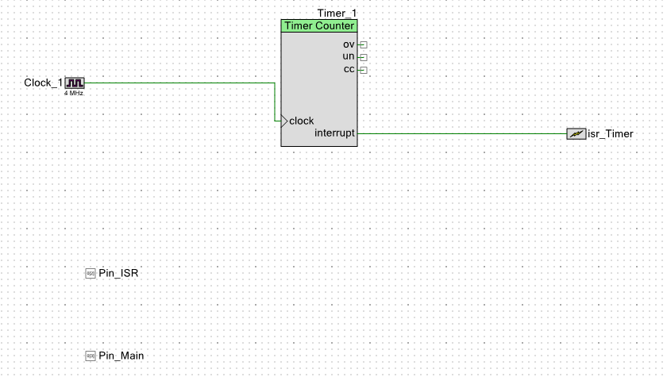

*Figure 1 – Schematic in TopDesign.cysch*

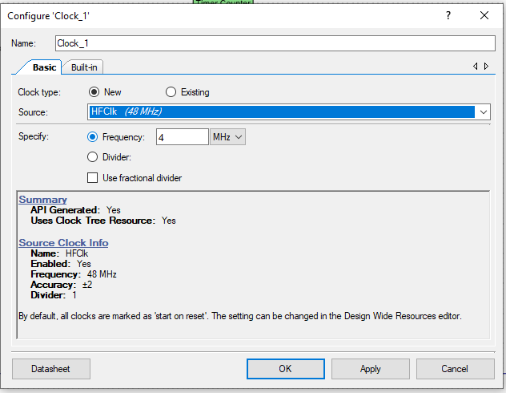

*Figure 2 – Clock_1 configuration (source HFCLK, 4 MHz)*

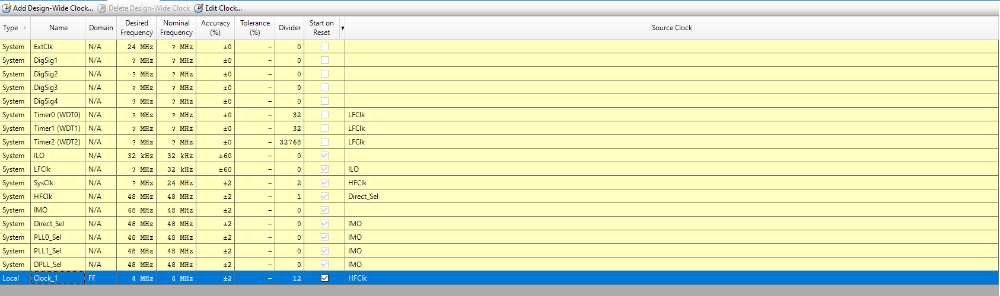

*Figure 3 – Clocks tab of lab1.cydwr: IMO 48 MHz, SysClk 24 MHz (divider 2), Clock_1 4 MHz (divider 12)*

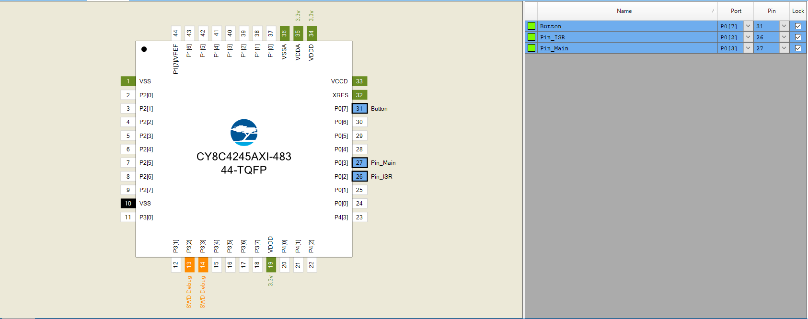

*Figure 4 – Pin assignment in lab1.cydwr (the `Button` pin is used in task 4)*

### Firmware (`task1/lab1.cydsn/main.c`)

```c
#define TIMER_PERIOD_TICKS   (400u - 1u)   /* 400 ticks of 0.25 us = 100 us */
#define MAIN_DELAY_MS        (1u)

volatile uint32_t isr_timer_count = 0u;

CY_ISR(Timer_ISR_Handler)
{
    Pin_ISR_Write((uint8)(!Pin_ISR_Read()));        /* toggle P0[2] */
    isr_timer_count++;
    Timer_1_ClearInterrupt(Timer_1_INTR_MASK_TC);   /* mandatory */
}

int main(void)
{
    CyGlobalIntEnable;

    Clock_1_Start();
    Timer_1_Start();
    Timer_1_WritePeriod(TIMER_PERIOD_TICKS);
    Timer_1_SetInterruptMode(Timer_1_INTR_MASK_TC);
    isr_Timer_StartEx(Timer_ISR_Handler);

    for (;;)
    {
        Pin_Main_Write(1u);
        CyDelay(MAIN_DELAY_MS);
        Pin_Main_Write(0u);
        CyDelay(MAIN_DELAY_MS);
    }
}
```

The ISR does the minimum amount of work: it toggles the pin, increments a counter and clears the
Terminal Count flag. The main loop toggles `Pin_Main` independently of the interrupt.

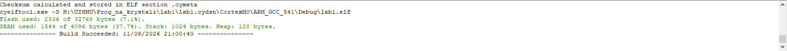

*Figure 5 – Build result (0 errors, 0 warnings)*

## Task 3 – Measurements with Saleae Logic 2

The firmware from `task1` was programmed into the CY8CKIT-042 kit and the signals were captured with a
Saleae Logic analyzer (24 MS/s, Timer capture mode). Channel D7 is connected to P0[2] (`Pin_ISR`),
channel D6 to P0[3] (`Pin_Main`) and GND to the ground of the kit. In the overview capture (Figure 6)
the two probes were swapped, so there `Pin_ISR` is on D6 and `Pin_Main` is on D7.

What is measured:

* **Interrupt period** – time between neighbouring edges of `Pin_ISR`; expected 100 µs
  (one full square-wave period is 200 µs because the pin toggles on every interrupt).
* **Main loop period** – full period of `Pin_Main`; expected 2 ms.
* **Main loop independence** – `Pin_Main` keeps running while the timer interrupt
  "squeezes in" between its edges.

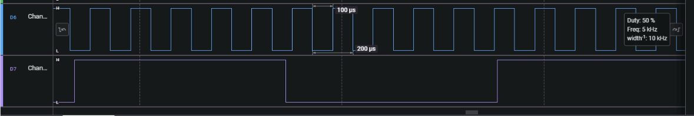

*Figure 6 – Pin_ISR (D6) and Pin_Main (D7) in Logic 2: 100 µs between toggles, 5 kHz, 50 % duty*

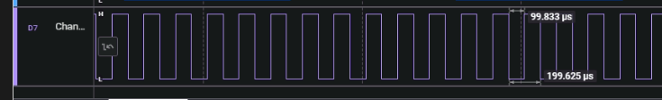

*Figure 7 – Interrupt period on Pin_ISR (D7): 99.833 µs between toggles, 199.625 µs full period*

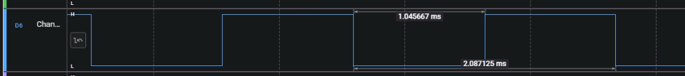

*Figure 8 – Main loop signal Pin_Main (D6): 1.046 ms high, 2.087 ms full period*

| Parameter / signal | Calculated | IDE Actual / Nominal | Measured (Saleae Logic 2) |
|--------------------|:----------:|:--------------------:|:-------------------------:|
| IMO | 48 MHz | 48 MHz | – |
| BUS_CLK (SysClk) | 24 MHz | 24 MHz (divider 2) | – |
| Clock_1 | 4 MHz | 4 MHz (divider 12) | – |
| Timer_1 Period register | 399 (400 ticks) | 399 | – |
| ISR signal period (Pin_ISR) | 0.100 ms | 0.100 ms | 0.0998 ms (99.833 µs) |
| Main loop signal period (Pin_Main) | 2.000 ms | 2.000 ms | 2.087 ms |

The internal clocks are not routed to any pin, so only the two signal periods can be measured.

**Analysis**

* The interrupt period differs from the calculated value by −0.17 %. This is well inside the ±2 %
  tolerance of the IMO and close to the time resolution of the capture. The hardware timer is not
  affected by the software running on the CPU.
* The main loop period is 4.4 % longer than calculated. `CyDelay()` is a busy-wait loop that counts CPU
  cycles, and it does not account for the time the CPU spends in the timer ISR. The interrupt fires
  10 times per millisecond; with roughly 4–5 µs for entry, handler and exit each time, every 1 ms delay
  grows by about 45 µs, which matches the measured 1.046 ms half-period.

## Task 4 – Button interrupt toggling the LED

A `Digital Input Pin` named `Button` (P0[7], resistive pull-up, interrupt on **falling edge**) and an
`isr_Button` component connected to its `irq` output were added to the schematic. The user button SW2
of the kit shorts P0[7] to ground when pressed, so one interrupt is generated per press.

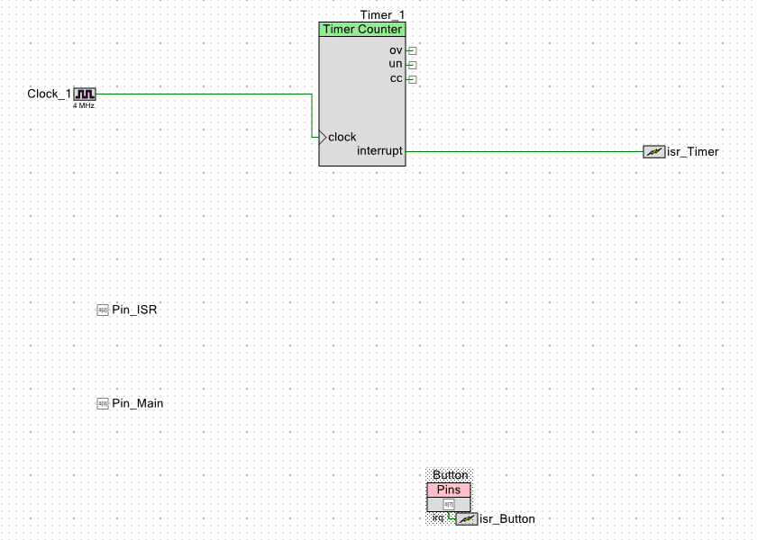

*Figure 9 – Modified schematic with the button and its interrupt*

### Firmware (`task2/lab1.cydsn/main.c`)

```c
CY_ISR(Button_Main_Handler)
{
    uint8 current_state = Pin_Main_Read();
    Pin_Main_Write((uint8)(!current_state));   /* LED on/off */
    button_count++;
    Button_ClearInterrupt();
}

int main(void)
{
    CyGlobalIntEnable;

    Clock_1_Start();
    Timer_1_Start();
    Timer_1_WritePeriod(TIMER_PERIOD_TICKS);
    Timer_1_SetInterruptMode(Timer_1_INTR_MASK_TC);

    isr_Timer_StartEx(Timer_ISR_Handler);
    isr_Button_StartEx(Button_Main_Handler);

    for (;;)
    {
        /* Pin_Main is driven only by the button ISR */
    }
}
```

The main loop no longer toggles `Pin_Main`; the blue LED is switched only by the button handler.

### Verification with Saleae Logic 2

The `task2` firmware was programmed into the kit and a 20 s capture was recorded while the button was
pressed several times (same wiring: D7 – `Pin_ISR`, D6 – `Pin_Main`). `Pin_ISR` keeps toggling every
100 µs and looks like a solid band at this zoom level, while `Pin_Main` changes its level only when the
button is pressed.

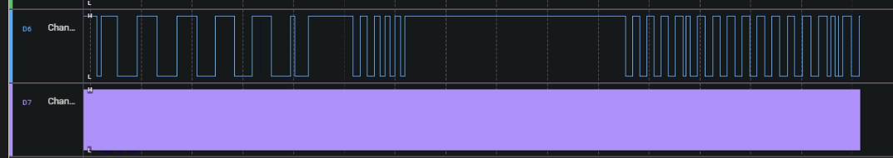

*Figure 10 – Pin_ISR (D7) and Pin_Main (D6) while the button is pressed several times*

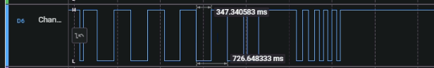

*Figure 11 – Pin_Main toggling after button presses (zoomed in, time between presses in ms)*

Several presses in a row produce short groups of toggles. The handler has no debouncing, so contact
bounce of the button can generate more than one falling edge per press.

## Conclusions

* The clock tree for variant 5 was configured as IMO = 48 MHz, BUS_CLK = 24 MHz (divider 2),
  Clock_1 = 4 MHz; all dividers are integers, so the calculated values match the values reported by
  PSoC Creator (error 0 %).
* The TCPWM timer with Period = 399 generates a Terminal Count interrupt every 400 ticks × 0.25 µs = 100 µs;
  the handler toggles `Pin_ISR` and clears the interrupt flag, while the main loop toggles `Pin_Main`
  with a 2 ms period independently of the ISR.
* A second interrupt source – the SW2 push button on P0[7] – was added; its handler toggles the LED on
  every press.
* Measurements on the CY8CKIT-042 kit with the Saleae Logic analyzer confirmed the design: the interrupt
  period is 99.833 µs (−0.17 %, within the IMO tolerance) and the main loop period is 2.087 ms (+4.4 %).
  The hardware timer stays accurate, while the software delay `CyDelay()` is stretched by the time spent
  in the interrupt handler.
* The button interrupt toggles `Pin_Main` on every press while the timer interrupt keeps running.
