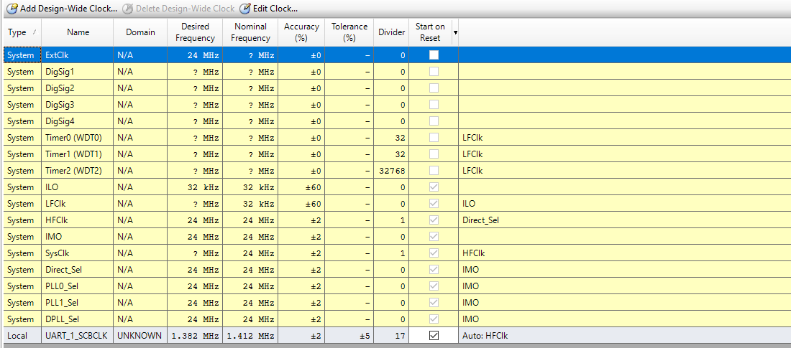
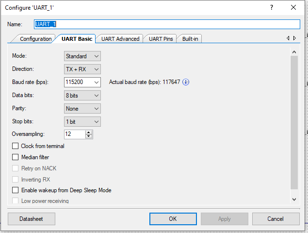
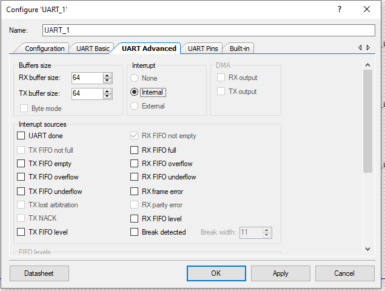
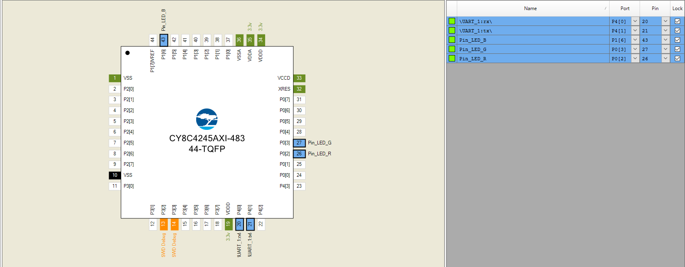
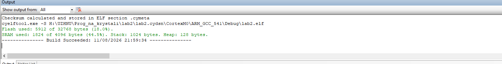
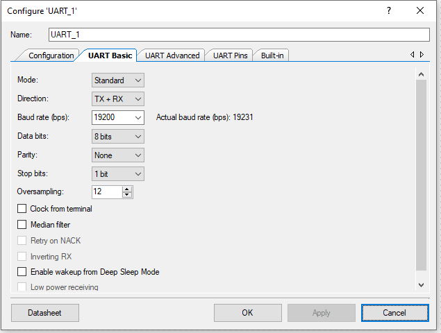
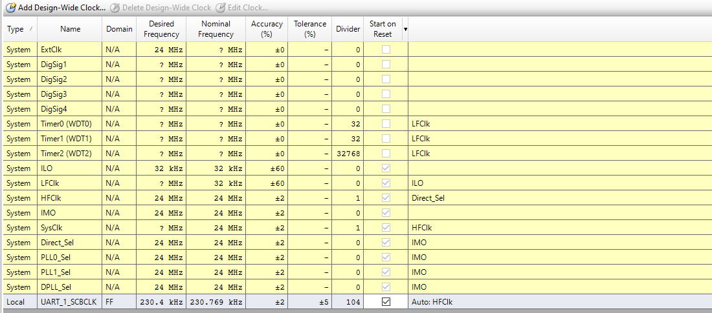
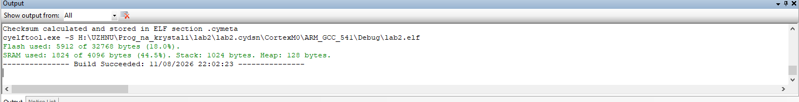

# Lab 2 – Asynchronous serial communication over UART (SCB) in PSoC 4

**Student:** Denys Hutsul, 4th year, Computer Engineering  
**Variant:** 5 (19200 bit/s, 8N1, new command `bin <n>`)  
**Board:** CY8CKIT-042 PSoC 4 Pioneer Kit (CY8C4245AXI-483)  
**IDE:** PSoC Creator 4.4

## Goal

Learn the principles of asynchronous serial communication (UART) and the configuration of the SCB block
in PSoC Creator, build a command-line console on top of the UART, and verify the timing of the signals
(bit duration, response latency) with the Saleae Logic analyzer.

## Variant data

| Part of the work | IMO | Baud rate | Frame | Commands |
|:-----------------|:---:|:---------:|:-----:|:---------|
| Base part (steps 1–10) | 24 MHz | 115200 | 8N1 | `echo`, `led`, `stats`, `blink` |
| Variant 5 | 24 MHz | 19200 | 8N1 | `bin <n>` |

## Repository layout

```
lab02_Hutsul/
├── task1/            minimal UART echo program (step 5 of the assignment), 115200 8N1
├── task2/            command-line console: help/ping/info/uptime/reboot + echo/led/stats/blink, 115200 8N1
├── task3/            variant 5: UART reconfigured to 19200 8N1, new command bin <n>
│   ├── lab2.cywrk
│   └── lab2.cydsn/   lab2.cyprj, lab2.cydwr, TopDesign/TopDesign.cysch, main.c
├── images/           screenshots used in this report
├── .gitignore        build output and generated code are not committed
└── README.md         this report
```

## How to run

1. Open `taskN/lab2.cywrk` in PSoC Creator 4.4 and press **Build → Build lab2** (`Shift+F6`).
2. Connect the CY8CKIT-042 kit over USB and press **Debug → Program** (`Ctrl+F5`).
   Make sure the SW4 switches route P4[0]/P4[1] to the KitProg USB-UART bridge.
3. Find the *KitProg USB-UART* COM port in Device Manager and open a terminal
   (Tera Term / PuTTY): **115200** for task1/task2 or **19200** for task3, 8 data bits, no parity,
   1 stop bit, no flow control, Enter sends CR, local echo off (the board echoes the characters).
4. Press the reset button: the board prints `=== Lab_2 UART console ===`, then type `help`.
5. For the measurements connect the Saleae Logic analyzer: D4 → P4_1 (TX of the PSoC),
   D5 → P4_0 (RX of the PSoC), D6 → P0_2 (red LED), D7 → P0_3 (green LED), GND → GND.

---

## Task 1 – Project preparation and clock check

The lab1 project was copied to `lab2` (project files renamed, generated folders removed), all lab1
components were deleted from the schematic and the clock tree was set to **IMO = 24 MHz**.
In the CY8C4245 (PSoC 4200) the HFCLK has no divider, so `HFCLK = SysClk (BUS CLK) = 24 MHz`.



*Figure 1 – Clocks tab of lab2.cydwr: IMO 24 MHz, SysClk 24 MHz, UART_1_SCBCLK divider 17*

## Task 2 – UART component

A `UART (SCB mode) v4.0` component named `UART_1` was placed with the following settings:

| Parameter | Value |
|-----------|-------|
| Mode / Direction | Standard / TX + RX |
| Baud rate | 115200 (task1, task2) · 19200 (task3) |
| Data bits / Parity / Stop bits | 8 / None / 1 |
| Oversampling | 12 |
| Interrupt | Internal |
| RX / TX buffer size | 64 / 64 bytes |
| Flow control | disabled |

**SCB clock for 115200 bit/s**

```
SCB clock = baud · OVS = 115200 · 12 = 1 382 400 Hz
divider   = IMO / SCB clock = 24 000 000 / 1 382 400 = 17.36 → 17 (integer peripheral divider)
SCB clock actual = 24 000 000 / 17 = 1 411 765 Hz
baud actual      = 1 411 765 / 12 = 117 647 bit/s      error = +2.12 %
```

PSoC Creator reports exactly these values: *Actual baud rate 117647* in the customizer and
*UART_1_SCBCLK: desired 1.382 MHz, nominal 1.412 MHz, divider 17* in the Clocks tab.



*Figure 2 – UART Basic tab (115200 bit/s, actual baud rate 117647)*



*Figure 3 – UART Advanced tab: internal interrupt, 64-byte RX and TX buffers*

## Task 3 – LED pins and schematic

Three `Digital Output Pin` components `Pin_LED_R`, `Pin_LED_G`, `Pin_LED_B`: Strong drive,
initial drive state **High (1)** (the on-board LEDs are active low, so they start switched off),
HW connection disabled.


*Figure 4 – Schematic of lab2.cydsn*

## Task 4 – Pin assignment

| Signal | Port | Pin | Purpose |
|--------|:----:|:---:|---------|
| `\UART_1:rx\` | P4[0] | 20 | RX of the PSoC (TX of KitProg) |
| `\UART_1:tx\` | P4[1] | 21 | TX of the PSoC (RX of KitProg) |
| `Pin_LED_R` | P0[2] | 26 | red LED |
| `Pin_LED_G` | P0[3] | 27 | green LED |
| `Pin_LED_B` | P1[6] | 43 | blue LED |



*Figure 5 – Pin assignment in lab2.cydwr*

## Task 5 – First run: minimal echo program (`task1`)

```c
int main(void)
{
    CyGlobalIntEnable;
    UART_1_Start();
    UART_1_UartPutString("\r\n=== Lab_2 UART ===\r\n");

    for (;;)
    {
        if (UART_1_SpiUartGetRxBufferSize() > 0u)
        {
            UART_1_UartPutChar(UART_1_SpiUartReadRxData());
        }
    }
}
```

The project builds without errors or warnings. After programming, pressing reset prints
`=== Lab_2 UART ===` in the terminal and every typed character is echoed back.



*Figure 6 – Build result (0 errors, 0 warnings)*

## Task 6 – Command-line console (`task2`)

The console skeleton works as follows: `SysTickTick()` increments `uptimeMs` every millisecond,
the main loop drains the UART RX buffer into `ProcessChar()`, which echoes characters, handles
Backspace and collects a line; on Enter `ExecuteLine()` splits the line into `argv[]`, looks `argv[0]`
up in `commandTable[]` and calls the handler (returns 1 on success, 0 on a user error).

Commands added in step 6.3:

| Command | Behaviour | Reply |
|---------|-----------|-------|
| `echo <text...>` | prints the received tokens | text + `\r\n` |
| `led <r\|g\|b\|all> <on\|off\|toggle>` | changes the LED state in `ledOn[]` through `LedWriteHw()`, cancels blinking of that LED | `OK` / `ERR usage: ...` |
| `stats` | prints `rxByteCount`, `cmdOkCount`, `cmdErrCount`, `lineOverflowCount` | one counter per line |
| `blink <r\|g\|b> <ms\|off>` | non-blocking blinking with a half period of 10…60000 ms | `OK` / `ERR usage: ...` |

`BlinkService()` is called from the main loop and toggles a LED when `(int32)(uptimeMs - blinkNextMs[i]) >= 0`,
then advances `blinkNextMs[i]` by the interval – the comparison stays correct after the counter wraps around.

Expected terminal session:

```
> foo                 ERR unknown command, type help   (not in commandTable, cmdErrCount++)
> echo hello world    hello world
> led r on            OK
> led all off         OK
> led x on            ERR usage: led <r|g|b|all> <on|off|toggle>   (unknown LED name)
> led r               ERR usage: led <r|g|b|all> <on|off|toggle>   (argc = 2, 3 tokens required)
> blink g 500         OK   (green LED toggles every 500 ms, period 1 s)
> blink g off         OK
> blink g 5           ERR usage: blink <r|g|b> <10..60000 ms|off>  (below the 10 ms limit)
> stats               rx bytes: N / cmd ok: 7 / cmd err: 4 / line overflow: 0
```

**Where is the ISR used?** There is no explicit `CY_ISR` in `main.c`, but two interrupts work in the
background: the internal ISR of `UART_1` moves received bytes from the hardware FIFO into the 64-byte
software RX buffer and feeds the TX FIFO from the TX buffer (so `UART_1_UartPutString()` returns almost
immediately), and `SysTickTick()` is called from the SysTick interrupt every 1 ms.

**What if `BlinkService()` is replaced by `CyDelay(500)`?** The main loop would block for 500 ms per
iteration: echo and command replies would be delayed by up to 0.5 s, fast input of more than 64 bytes
would overflow the RX buffer, and several LEDs with different periods could not be blinked independently.

## Task 7–9 – Saleae Logic measurements and failure experiments

Two *Async Serial* analyzers (115200, 8 bits, 1 stop, no parity, LSB first) are attached to D4 and D5.
For `ping` the PC line (D5) carries `70 69 6E 67 0D`, the board line (D4) carries the echo,
`0D 0A`, `pong`, `0D 0A` and the prompt `> `.

Expected values for 115200 bit/s:

| Parameter | Calculated | IDE actual | Saleae |
|-----------|:----------:|:----------:|:------:|
| T_bit | 8.68 µs | 8.50 µs (117647 bit/s) | *measured on the board* |
| Baud | 115200 | 117647 | *measured on the board* |
| Echo delay | – | – | *measured on the board* |
| `ping` response delay | – | – | *measured on the board* |
| Duration of `pong\r\n` | 6 · 10 · 8.68 = 520.8 µs | 510 µs | *measured on the board* |
| `led r on` → D6 | – | – | *measured on the board* |
| Blink period (`blink g 500`) | 1000 ms | 1000 ms (SysTick from the 24 MHz IMO, ±2 %) | *measured on the board* |

Failure experiments (described, to be captured on the board):

* **Wrong baud rate (57600 in the terminal):** garbage or nothing in the terminal; the analyzer set to
  115200 decodes only the board line correctly, set to 57600 only the PC line – both sides are "right"
  for their own speed, they are simply not matched.
* **Even parity in the terminal:** the board sees the parity bit where it expects the stop bit
  (frame errors), the terminal reports parity errors on the board's replies; the problem is on the
  terminal side.
* **Fast stream (10 lines of `ping` pasted at once):** 50 bytes fit into the 64-byte RX buffer, but the
  140 bytes of replies exceed the 64-byte TX buffer, so `UART_1_UartPutString()` waits for free space and
  the main loop slows down; with longer pastes the RX buffer can overflow (`lineOverflowCount` grows).

## Task 10 – Variant 5: 19200 bit/s, 8N1, command `bin <n>` (`task3`)

```
SCB clock = 19200 · 12 = 230 400 Hz
divider   = 24 000 000 / 230 400 = 104.17 → 104
SCB clock actual = 24 000 000 / 104 = 230 769 Hz
baud actual      = 230 769 / 12 = 19 231 bit/s        error = +0.16 %

bits per byte = 1 start + 8 data + 0 parity + 1 stop = 10
T_bit  = 1 / 19200 = 52.08 µs   (actual 52.00 µs)
T_byte = 10 · 52.08 = 520.8 µs  (actual 520.0 µs)
```

Error of the baud rate for different oversampling values (IMO = 24 MHz):

| Baud | OVS | SCB clock | Divider | Actual baud | Error |
|:----:|:---:|:---------:|:-------:|:-----------:|:-----:|
| 19200 | 8 | 153 600 | 156.25 → 156 | 19 231 | +0.16 % |
| 19200 | 12 | 230 400 | 104.17 → 104 | 19 231 | +0.16 % |
| 19200 | 16 | 307 200 | 78.125 → 78 | 19 231 | +0.16 % |
| 115200 | 8 | 921 600 | 26.04 → 26 | 115 385 | +0.16 % |
| 115200 | 12 | 1 382 400 | 17.36 → 17 | 117 647 | +2.12 % |
| 115200 | 16 | 1 843 200 | 13.02 → 13 | 115 385 | +0.16 % |

For 19200 bit/s all three OVS values give the same 0.16 % error, so OVS = 12 is kept; for 115200 bit/s
OVS = 8 or 16 would be a better choice than the default 12.



*Figure 7 – UART Basic tab for variant 5 (actual baud rate 19231)*



*Figure 8 – Clocks tab: UART_1_SCBCLK 230.4 kHz → 230.769 kHz, divider 104*

### Command `bin <n>`

```c
/* bin <n> : prints the number in binary without leading zeros, e.g. bin 10 -> 1010 */
static uint8 CmdBin(uint8 argc, char *argv[])
{
    static const char usage[] = "bin <n>";
    uint32 value;
    char   bits[33];
    uint8  pos = (uint8)sizeof(bits);

    if (argc != 2u)
    {
        return ErrorUsage(usage);
    }
    if (!ParseU32(argv[1], &value))
    {
        return ErrorUsage(usage);
    }

    bits[--pos] = '\0';
    do
    {
        bits[--pos] = (char)('0' + (value & 1u));
        value >>= 1u;
    } while (value != 0u);

    Print(&bits[pos]);
    Print("\r\n");
    return 1u;
}
```

Terminal session examples:

```
> bin 10              1010
> bin 0               0
> bin 255             11111111
> bin 4294967295      11111111111111111111111111111111
> bin                 ERR usage: bin <n>        (missing argument)
> bin 12a             ERR usage: bin <n>        (not a decimal digit)
> bin 1 2             ERR usage: bin <n>        (too many arguments)
> bin 4294967296      ERR usage: bin <n>        (uint32 overflow in ParseU32)
```

Expected duration of the reply to `bin 10` (`1010\r\n`, 6 bytes): `6 · 10 · 52.08 µs = 3.125 ms`.



*Figure 9 – Build result for variant 5*

## Conclusions

* The SCB UART was configured in PSoC Creator; for 115200 bit/s the integer divider 17 gives an actual
  rate of 117 647 bit/s (+2.12 %), for the variant speed 19200 bit/s the divider 104 gives 19 231 bit/s
  (+0.16 %) – both values match the ones reported by the customizer and the Clocks tab.
* A command-line console with a command table was implemented; `echo`, `led`, `stats` and a
  non-blocking `blink` based on SysTick were added, and for variant 5 the command `bin <n>` with full
  input validation.
* Comparing oversampling factors showed that for 115200 bit/s OVS 8 or 16 reduce the baud-rate error
  from 2.12 % to 0.16 %.
* All three projects build without errors or warnings; the Saleae Logic measurements (bit duration,
  echo/response latency, blink period) are performed on the CY8CKIT-042 kit.
