# Lab 2 – Asynchronous serial communication over UART (SCB) in PSoC 4

**Student:** Denys Hutsul, 4th year, Computer Engineering  
**Variant:** 5 (19200 bit/s, 8N1, new command `bin <n>`)  
**Board:** CY8CKIT-042 PSoC 4 Pioneer Kit (CY8C4245AXI-483)  
**IDE:** PSoC Creator 4.4  
**Full report (PDF, Ukrainian):** [Lab2_Hutsul_report.pdf](Lab2_Hutsul_report.pdf)

## Goal

Learn the principles of asynchronous serial communication (UART) and the configuration of the SCB block
in PSoC Creator, learn to send and receive frames and check their integrity, and measure the timing
of the signals with the Saleae Logic analyzer.

## Variant data

| Part of the work | IMO | Baud rate | Frame | Commands |
|:-----------------|:---:|:---------:|:-----:|:---------|
| Base part | 24 MHz | 115200 | 8N1 | `echo`, `led`, `stats`, `blink` |
| Variant 5 | 24 MHz | 19200 | 8N1 | `bin <n>` |

## Repository layout

```
lab02_Hutsul/
├── task1/            minimal UART echo program, 115200 8N1
├── task2/            command-line console: help/ping/info/uptime/reboot + echo/led/stats/blink, 115200 8N1
├── task3/            variant 5: UART reconfigured to 19200 8N1, new command bin <n>
│   ├── lab2.cywrk
│   └── lab2.cydsn/   lab2.cyprj, lab2.cydwr, TopDesign/TopDesign.cysch, main.c
├── images/           screenshots used in this report (PSoC Creator, terminal, Saleae Logic 2)
├── Lab2_Hutsul_report.pdf   full lab report submitted to the teacher (Ukrainian)
├── .gitignore        build output and generated code are not committed
└── README.md         this report
```

## How to run

1. Open `taskN/lab2.cywrk` in PSoC Creator 4.4 and press **Build → Build lab2** (`Shift+F6`).
2. Connect the CY8CKIT-042 kit over USB (J10) and press **Debug → Program** (`Ctrl+F5`).
   On the CY8CKIT-042 the KitProg USB-UART bridge is **not** routed to the PSoC 4 on the PCB:
   connect it with two jumper wires, `J8_10` (KitProg TX) → `J3_10` (P4[0], PSoC RX) and
   `J8_9` (KitProg RX) → `J3_09` (P4[1], PSoC TX).
3. Find the *KitProg USB-UART* COM port in Device Manager and open a terminal
   (PuTTY / Tera Term): **115200** for task1/task2 or **19200** for task3, 8 data bits, no parity,
   1 stop bit, no flow control, Enter sends CR, local echo off (the board echoes the characters).
4. Press the reset button: the board prints `=== Lab_2 UART console ===`, then type `help`.
5. Saleae Logic channels used for the measurements: D4 → P4_1 (TX of the PSoC), D5 → P4_0 (RX of the PSoC),
   D6 → P0_3 (`Pin_LED_G`), D7 → P0_2 (`Pin_LED_R`), GND → GND.

---

## Task 1 – Project preparation, component configuration and basic test

The lab1 project was copied to `lab2` (project files renamed, generated folders removed), all lab1
components were deleted from the schematic and the clock tree was set to **IMO = 24 MHz**.
In the CY8C4245 (PSoC 4200) the HFCLK has no divider, so `HFCLK = SysClk = 24 MHz`.

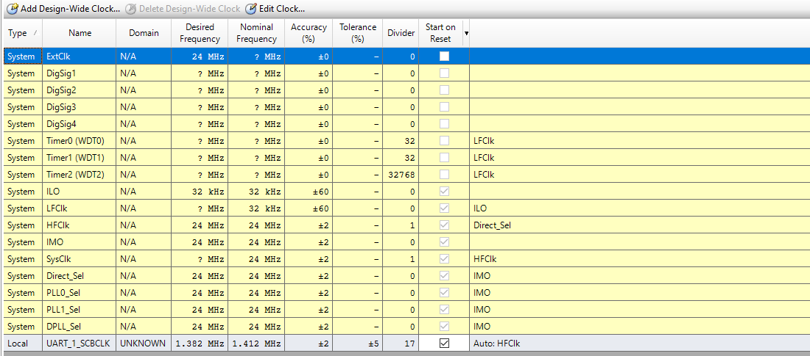

*Figure 1 – Clocks tab of lab2.cydwr: IMO 24 MHz, SysClk 24 MHz, UART_1_SCBCLK divider 17*

A `UART (SCB mode) v4.0` component named `UART_1` and three `Digital Output Pin` components
`Pin_LED_R`, `Pin_LED_G`, `Pin_LED_B` were placed (pins: Strong drive, initial state **High (1)** because
the on-board LEDs are active low, HW connection disabled).

| UART_1 parameter | Value |
|------------------|-------|
| Mode / Direction | Standard / TX + RX |
| Baud rate | 115200 (task1, task2) · 19200 (task3) |
| Data bits / Parity / Stop bits | 8 / None / 1 |
| Oversampling | 12 |
| Interrupt | Internal |
| RX / TX buffer size | 64 / 64 bytes |
| Flow control | disabled |

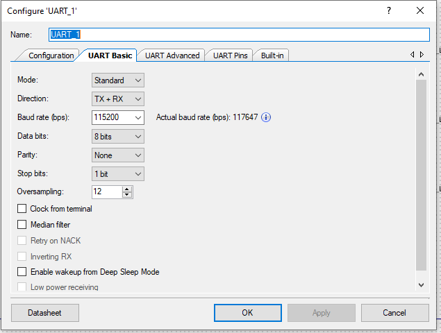

*Figure 2 – UART Basic tab (115200 bit/s, actual baud rate 117647)*

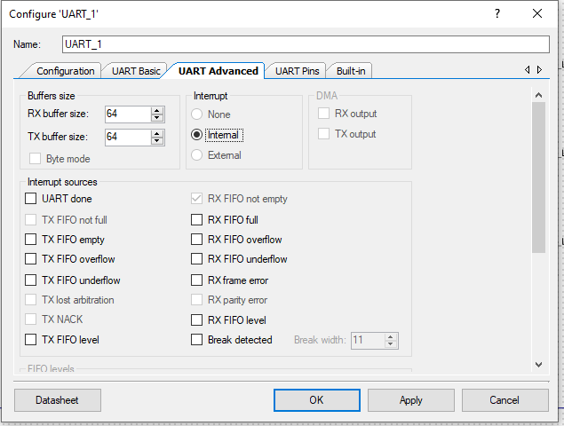

*Figure 3 – UART Advanced tab: internal interrupt, 64-byte RX and TX buffers*


*Figure 4 – Schematic of lab2.cydsn*

**SCB clock for 115200 bit/s**

```
SCB clock = baud · OVS = 115200 · 12 = 1 382 400 Hz
divider   = IMO / SCB clock = 24 000 000 / 1 382 400 = 17.36 → 17 (integer peripheral divider)
baud actual = 24 000 000 / (17 · 12) = 117 647 bit/s      error = +2.12 %
```

PSoC Creator reports exactly these values: *Actual baud rate 117647* in the customizer and
*UART_1_SCBCLK: desired 1.382 MHz, nominal 1.412 MHz, divider 17* in the Clocks tab.

| Signal | Port | Pin | Purpose |
|--------|:----:|:---:|---------|
| `\UART_1:rx\` | P4[0] | 20 | RX of the PSoC ← `J8_10` (TX of KitProg) |
| `\UART_1:tx\` | P4[1] | 21 | TX of the PSoC → `J8_9` (RX of KitProg) |
| `Pin_LED_R` | P0[2] | 26 | channel R (physically the green LED) |
| `Pin_LED_G` | P0[3] | 27 | channel G (physically the blue LED) |
| `Pin_LED_B` | P1[6] | 43 | channel B (physically the red LED) |

P4[0]/P4[1] are brought out to the Arduino header J3 (`J3_10`, `J3_09`). On the CY8CKIT-042 they are
not connected to the KitProg on the PCB: the UART lines of the PSoC 5LP (KitProg) are on header J8
(`J8_9` = P12[6] RX, `J8_10` = P12[7] TX), so two jumper wires are required.
The LED pins follow the assignment, but on the kit P0[2] drives the green, P0[3] the blue and P1[6] the red
die of the RGB LED, so `led r` physically lights green, `led g` blue and `led b` red.

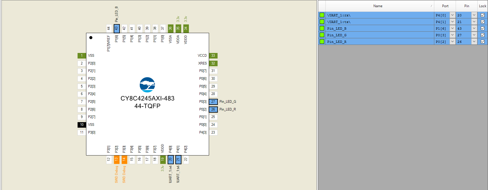

*Figure 5 – Pin assignment in lab2.cydwr*

Minimal program (`task1`) that checks the path PC → KitProg → PSoC → PC:

```c
int main(void)
{
    CyGlobalIntEnable;
    UART_1_Start();
    UART_1_UartPutString("\r\n=== Lab_2 UART ===\r\n");

    for (;;)
    {
        if (UART_1_SpiUartGetRxBufferSize() > 0u)
        {
            UART_1_UartPutChar(UART_1_SpiUartReadRxData());
        }
    }
}
```

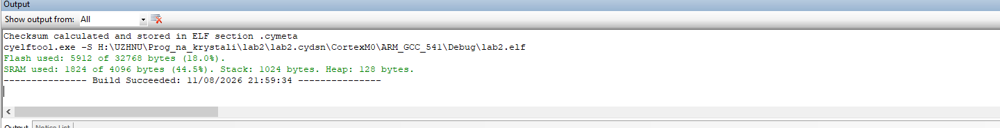

*Figure 6 – Build result (0 errors, 0 warnings)*

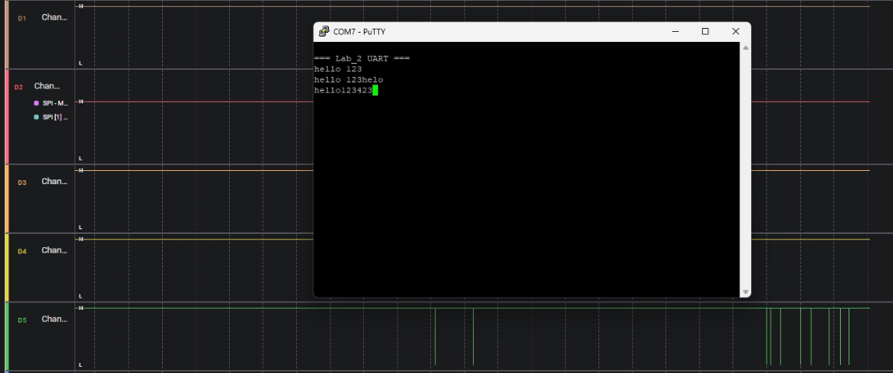

*Figure 7 – PuTTY: greeting after reset and echo of the typed characters*

## Task 2 – Command-line console (CLI) and new commands (`task2`)

The console skeleton works as follows: `SysTickTick()` increments `uptimeMs` every millisecond,
the main loop drains the UART RX buffer into `ProcessChar()`, which echoes characters, handles
Backspace and collects a line; on Enter `ExecuteLine()` splits the line into `argv[]`, looks `argv[0]`
up in `commandTable[]` and calls the handler (returns 1 on success, 0 on a user error).

Added commands:

| Command | Behaviour | Reply |
|---------|-----------|-------|
| `echo <text...>` | prints the received tokens | text + `\r\n` |
| `led <r\|g\|b\|all> <on\|off\|toggle>` | changes the LED state in `ledOn[]` through `LedWriteHw()`, cancels blinking of that LED | `OK` / `ERR usage: ...` |
| `stats` | prints `rxByteCount`, `cmdOkCount`, `cmdErrCount`, `lineOverflowCount` | one counter per line |
| `blink <r\|g\|b> <ms\|off>` | non-blocking blinking with a half period of 10…60000 ms | `OK` / `ERR usage: ...` |

`BlinkService()` is called from the main loop and toggles a LED when `(int32)(uptimeMs - blinkNextMs[i]) >= 0`,
then advances `blinkNextMs[i]` by the interval – the comparison stays correct after the counter wraps around.

Terminal session on the board (Figure 8):

```
> uptime              63660 ms
> foo                 ERR unknown command, type help   (not in commandTable, cmdErrCount++)
> echo hello world    hello world
> led r on            OK
> led all off         OK
> led x on            ERR usage: led <r|g|b|all> <on|off|toggle>   (unknown LED name)
> led r               ERR usage: led <r|g|b|all> <on|off|toggle>   (argc = 2, 3 tokens required)
> blink g 500         OK   (channel G LED toggles every 500 ms, period 1 s)
> blink g off         OK
> blink g 5           ERR usage: blink <r|g|b> <10..60000 ms|off>  (below the 10 ms limit)
> stats               rx bytes: 124 / cmd ok: 9 / cmd err: 4 / line overflow: 0
```

The 9 successful commands are `help`, `ping`, `info`, `uptime`, `echo`, `led r on`, `led all off`,
`blink g 500`, `blink g off`; the 4 failed ones are `foo`, `led x on`, `led r`, `blink g 5`.

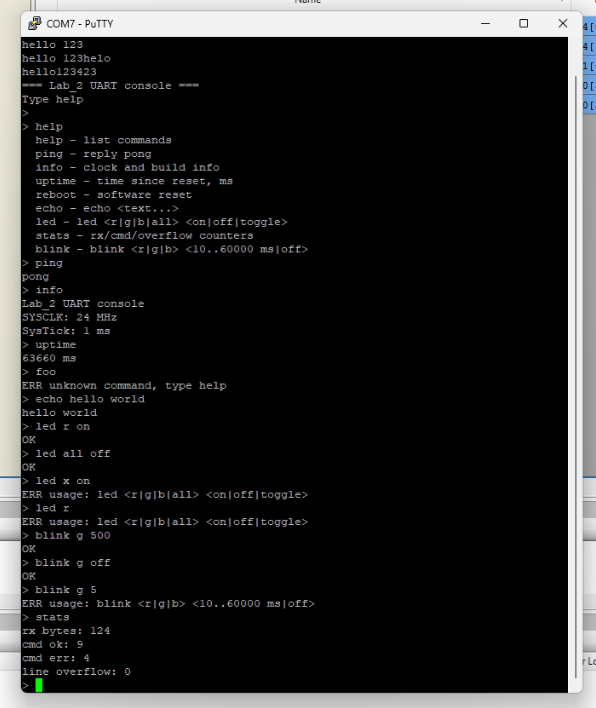

*Figure 8 – Basic and added console commands tested on the board*

**Where is the ISR used?** There is no explicit `CY_ISR` in `main.c`, but two interrupts work in the
background: the internal ISR of `UART_1` moves received bytes from the hardware FIFO into the 64-byte
software RX buffer and feeds the TX FIFO from the TX buffer (so `UART_1_UartPutString()` returns almost
immediately), and `SysTickTick()` is called from the SysTick interrupt every 1 ms.

**What if `BlinkService()` is replaced by `CyDelay(500)`?** The main loop would block for 500 ms per
iteration: echo and command replies would be delayed by up to 0.5 s, fast input of more than 64 bytes
would overflow the RX buffer, and several LEDs with different periods could not be blinked independently.

## Task 3 – UART decoding and timing measurements in Saleae Logic

Two *Async Serial* analyzers (115200, 8 bits, 1 stop, no parity, LSB first) are attached to D4 and D5,
trigger – falling edge on D5. For `ping` the PC line (D5) carries `70 69 6E 67 0D`, the board line (D4)
carries the echo, `0D 0A`, `pong`, `0D 0A` and the prompt `> `.

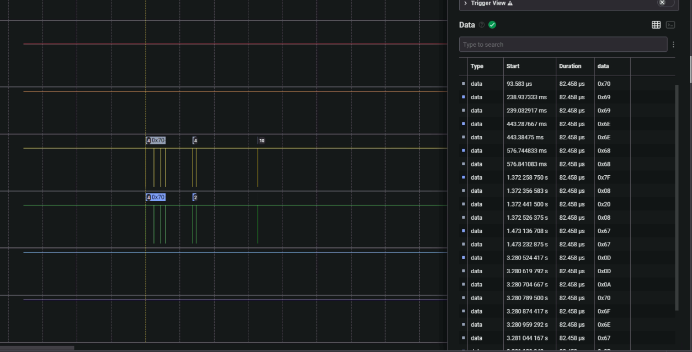

*Figure 9 – Decoding of the `ping` exchange (D4 – TX of the board, D5 – RX of the board)*

**3.1 Bit duration and baud rate.** `echo UUUU` (`U` = 0x55 alternates 0/1). Logic 2 shows a bit width of
8.5 µs, a period of 17 µs (58.824 kHz) and 1/width = 117.647 kHz:
`baud = 1 / 8.5 µs ≈ 117 647 bit/s`, `+2.12 %` from 115200 – exactly the actual rate of the integer divider 17.

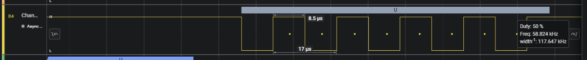

*Figure 10 – Bit duration on D4*

**3.2 Echo delay.** The end of the stop bit has no edge, so the marker is placed on the last rising edge of
the frame on D5 (start of the stop bit) and one PC bit (1 / 115200 = 8.68 µs) is subtracted:
`18.70 − 8.68 ≈ 10.0 µs`. During this time the UART ISR moves the byte into the RX buffer, the main loop
reads it, `ProcessChar()` puts the echo into the TX buffer and the SCB starts the start bit.

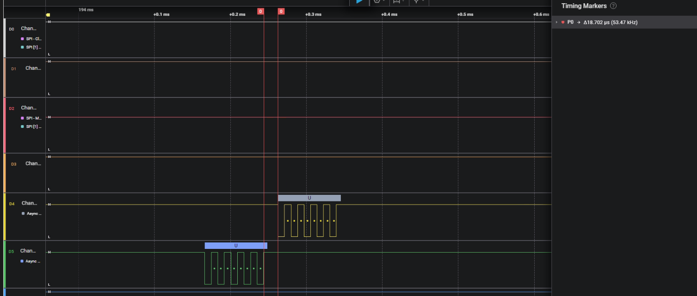

*Figure 11 – Echo delay*

**3.3 `ping` response delay.** From the start of the stop bit of `0x0D` on D5 to the first reply byte on D4:
`19.48 − 8.68 ≈ 10.8 µs` – only 0.8 µs longer than the echo, because `ProcessChar()` queues `\r\n`
immediately on CR and parses the line while these bytes are being sent (no gap between `0x0A` and `0x70`).

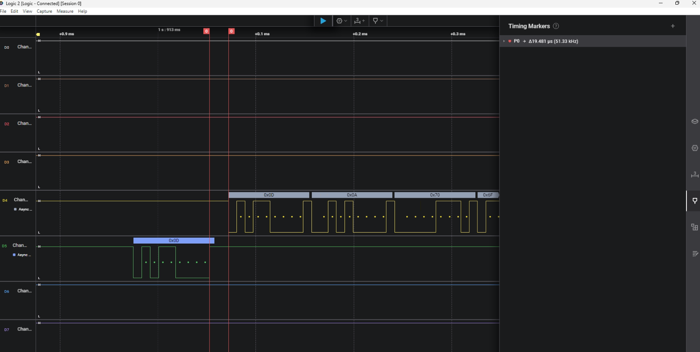

*Figure 12 – Delay of the reply to `ping`*

**3.4 Duration of `pong\r\n`.** 6 bytes × 10 bits. The markers show 505.97 µs, but the end marker sits in the
middle of the stop bit of the second `0x0A`, half a bit (≈ 4.3 µs) before the next byte `0x3E`, so the full
duration is ≈ 510 µs = `6 · 10 · 8.50 µs` (actual rate); with the nominal 115200 it would be 520.8 µs.

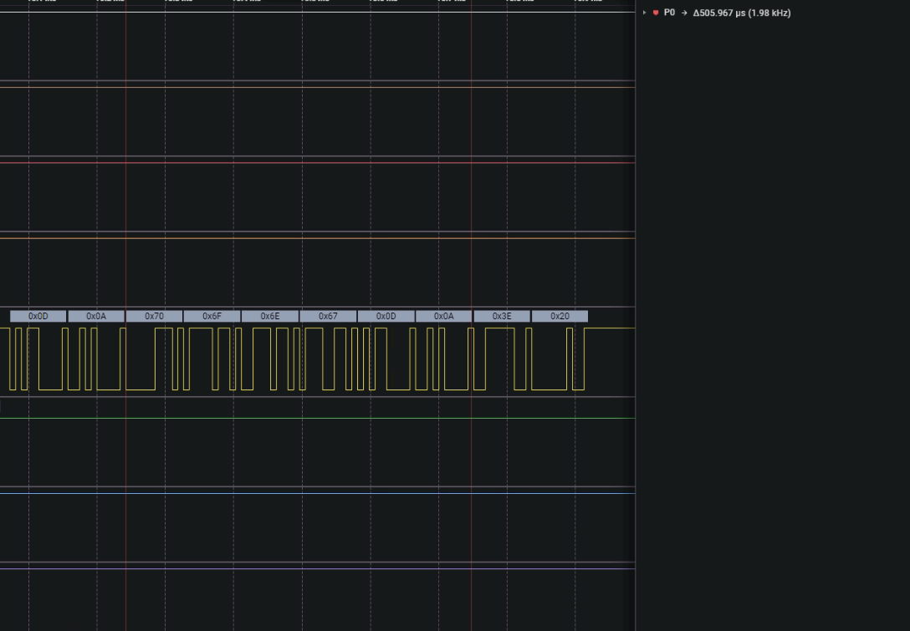

*Figure 13 – Duration of the reply `pong\r\n` on D4*

**3.5 LED control delay.** After `led r on` the channel R LED (P0[2], on D7) turns on with a falling edge
≈ 44.4 µs after the start of the stop bit of `0x0D` on D5 (read from the time scale, ±1 µs), i.e.
`44.4 − 8.68 ≈ 35.7 µs`. The reply `\r\n` on D4 starts already after 15.3 µs; the LED edge comes ≈ 29 µs later
because `ExecuteLine()` tokenizes the line, finds `led` in the table, `CmdLed()` checks the arguments and
`LedSet()` drives the pin.

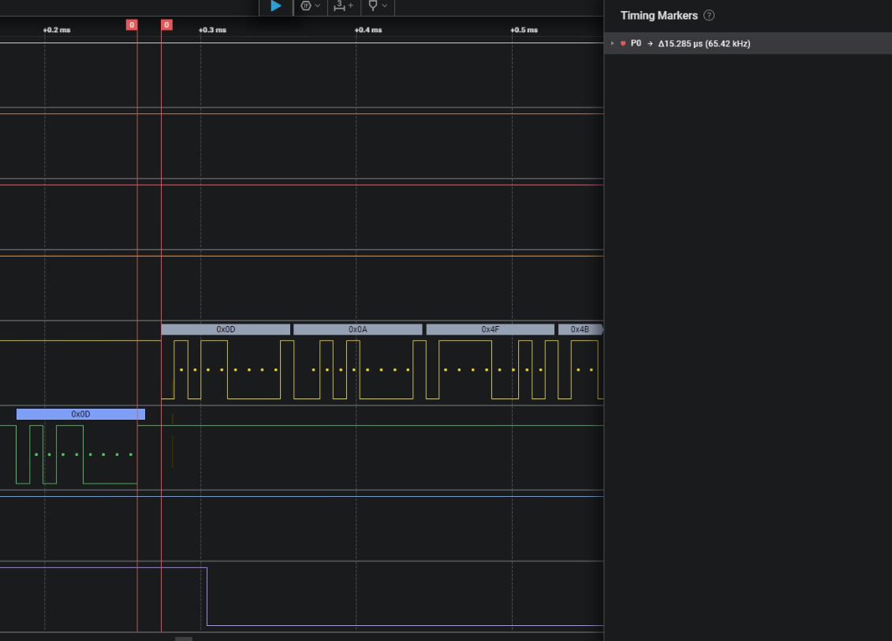

*Figure 14 – From the end of `led r on` to the reply and the LED edge (D7)*

**3.6 Blink accuracy.** `blink g 500`: the period on D6 between two falling edges is 1.000082 s =
1000.08 ms (+0.008 %); SysTick runs from SysClk = IMO = 24 MHz, far better than the ±2 % IMO tolerance.

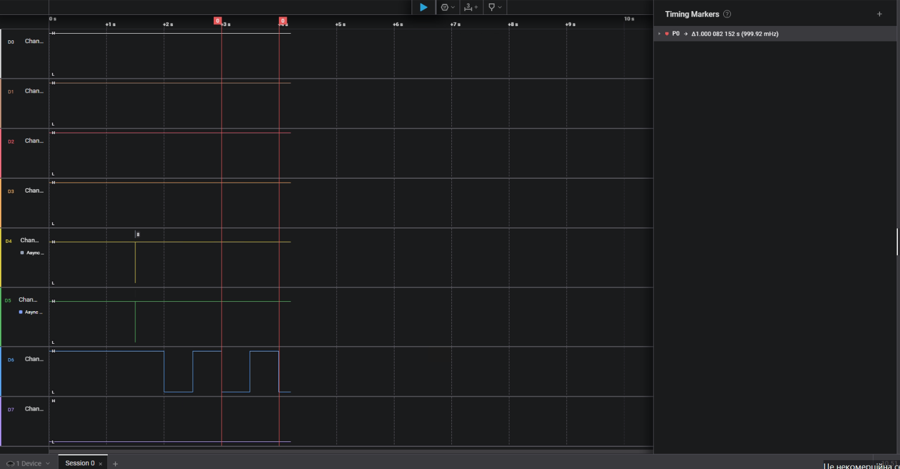

*Figure 15 – Blink period*

| Parameter (115200 bit/s) | Calculated | Saleae | Difference |
|--------------------------|:----------:|:------:|:----------:|
| T_bit, µs | 8.68 (8.50 actual) | 8.50 | −0.18 (−2.1 %) |
| Baud, bit/s | 115200 (117647 actual) | 117 647 | +2447 (+2.12 %) |
| Echo delay, µs | – | ≈ 10.0 (18.70 − 8.68) | – |
| `ping` response delay, µs | – | ≈ 10.8 (19.48 − 8.68) | – |
| Duration of `pong\r\n`, µs | 6 · 86.8 = 520.8 | ≈ 510 (505.97 + ½ stop bit) | −10.8 (−2.1 %) vs 520.8; ≈ 0 vs 510 |
| `led r on` → D7, µs | – | ≈ 35.7 (44.4 − 8.68) | – |
| Blink period, ms | 1000 | 1000.08 | +0.08 (+0.008 %) |

## Task 4 – Failure experiments

**1. Wrong baud rate (57600 in the terminal, board at 115200).** With the analyzers at 115200, the PC bytes on
D5 decode as `0x78`, `0x60`, `0x1E`, `0xFE`, partly with framing errors. The board echoes only the printable
ones (`0x78` "x", `0x60` "`") – `ProcessChar()` accepts 0x20…0x7E only – and the terminal at 57600 shows them
as garbage. The CR is corrupted too, so the line never ends and `ping` is not executed (no `pong` on D4).
Each side transmits correctly for its own speed; the speeds simply do not match.

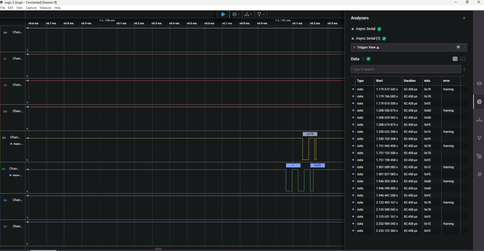

*Figure 16 – Terminal at 57600 bit/s, analyzers at 115200 bit/s*

**2. Even parity in the terminal.** Everything kept working: `ping` was answered and Saleae with 8N1 decodes
both lines without errors. The KitProg USB-UART bridge supports only 8 data bits without parity
(CY8CKIT-042 Kit Guide, table 3-2), so it ignores the parity setting and still sends 8N1 frames. A real parity
mismatch can only be shown by setting Parity = Even in `UART_1` or with a separate USB-UART adapter.

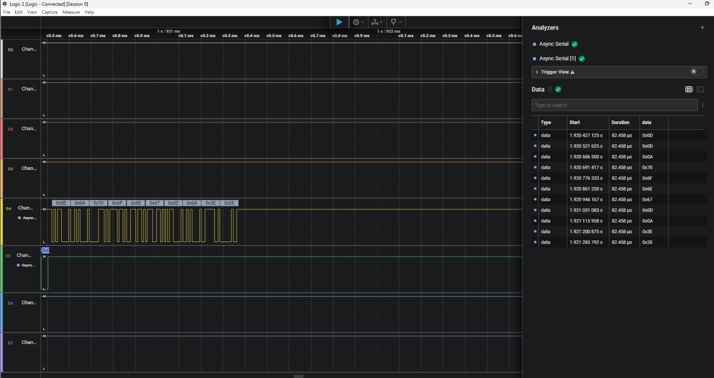

*Figure 17 – Signals with Even parity selected in the terminal*

**3. Fast stream.** Several `ping` lines pasted at once give a continuous stream of 40 bytes on D5
(8 commands × 5 bytes). The board starts answering while still receiving; every command produces 14 reply
bytes (echo, `\r\n`, `pong\r\n`, `> `), 112 bytes in total (≈ 9.5 ms at 117 647 bit/s vs ≈ 3.5 ms of input).
The 64-byte RX buffer holds all input, the 64-byte TX buffer fills up so `UART_1_UartPutString()` waits and
the main loop slows down, but the `pong` replies on D4 follow each other without gaps. Longer pastes can
overflow the RX buffer (`lineOverflowCount` grows).

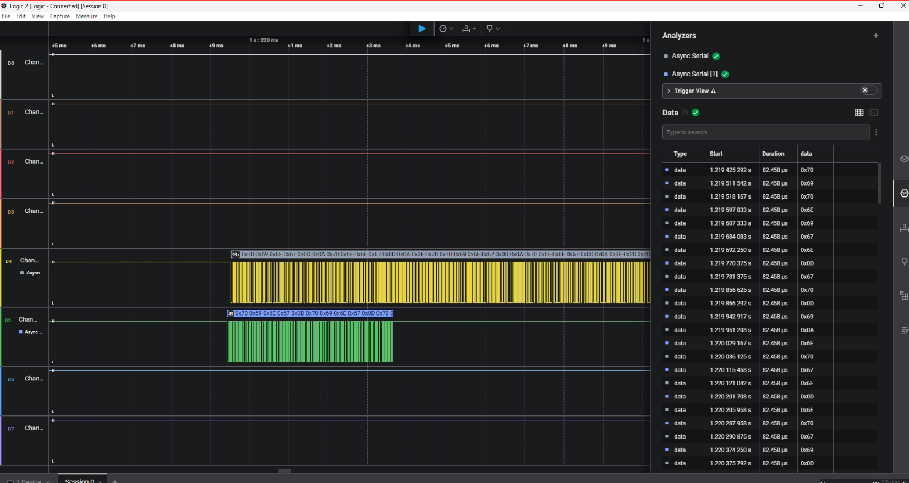

*Figure 18 – Several `ping` commands pasted at once*

## Task 5 – Variant 5: 19200 bit/s, 8N1, command `bin <n>` (`task3`)

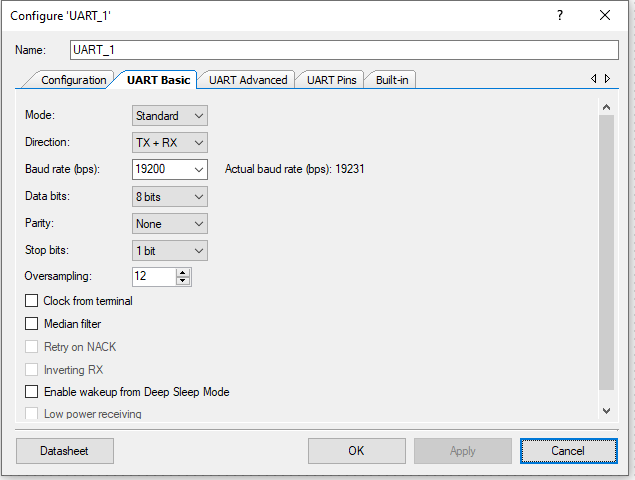

*Figure 19 – UART Basic tab for variant 5 (actual baud rate 19231)*

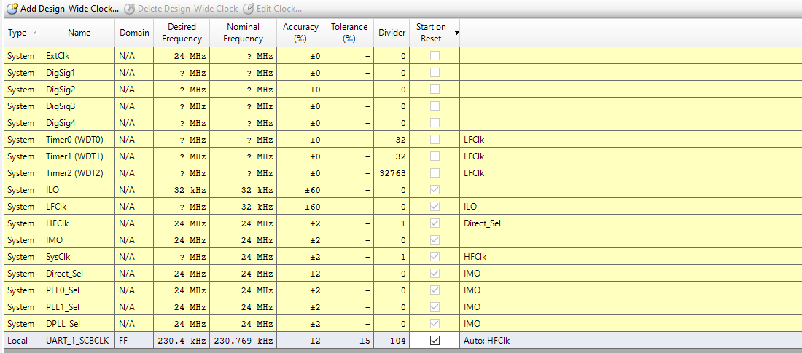

*Figure 20 – Clocks tab: UART_1_SCBCLK 230.769 kHz, divider 104*

```
SCB clock = 19200 · 12 = 230 400 Hz
divider   = 24 000 000 / 230 400 = 104.17 → 104
baud actual = 24 000 000 / (104 · 12) = 19 231 bit/s        error = +0.16 %

T_bit  = 1 / 19200 = 52.08 µs   (actual 52.00 µs)
T_byte = 10 · 52.08 = 520.8 µs  (actual 520.0 µs)
```

| Baud | OVS | SCB clock | Divider | Actual baud | Error |
|:----:|:---:|:---------:|:-------:|:-----------:|:-----:|
| 19200 | 8 | 153 600 | 156.25 → 156 | 19 231 | +0.16 % |
| 19200 | 12 | 230 400 | 104.17 → 104 | 19 231 | +0.16 % |
| 19200 | 16 | 307 200 | 78.125 → 78 | 19 231 | +0.16 % |
| 115200 | 8 | 921 600 | 26.04 → 26 | 115 385 | +0.16 % |
| 115200 | 12 | 1 382 400 | 17.36 → 17 | 117 647 | +2.12 % |
| 115200 | 16 | 1 843 200 | 13.02 → 13 | 115 385 | +0.16 % |

For 19200 bit/s all three OVS values give the same 0.16 % error, so OVS = 12 is kept; for 115200 bit/s
OVS = 8 or 16 would be a better choice than the default 12.

### Command `bin <n>`

```c
/* bin <n> : prints the number in binary without leading zeros, e.g. bin 10 -> 1010 */
static uint8 CmdBin(uint8 argc, char *argv[])
{
    static const char usage[] = "bin <n>";
    uint32 value;
    char   bits[33];
    uint8  pos = (uint8)sizeof(bits);

    if (argc != 2u)
    {
        return ErrorUsage(usage);
    }
    if (!ParseU32(argv[1], &value))
    {
        return ErrorUsage(usage);
    }

    bits[--pos] = '\0';
    do
    {
        bits[--pos] = (char)('0' + (value & 1u));
        value >>= 1u;
    } while (value != 0u);

    Print(&bits[pos]);
    Print("\r\n");
    return 1u;
}
```

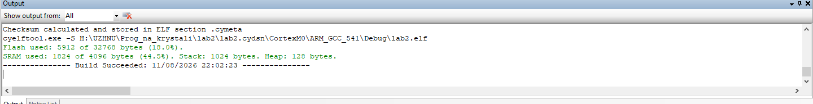

*Figure 21 – Build result for variant 5*

Terminal session on the board:

```
> bin 10              1010
> bin 0               0
> bin 255             11111111
> bin 4294967295      11111111111111111111111111111111
> bin                 ERR usage: bin <n>        (missing argument)
> bin 12a             ERR usage: bin <n>        (not a decimal digit)
> bin 1 2             ERR usage: bin <n>        (too many arguments)
> bin 4294967296      ERR usage: bin <n>        (uint32 overflow in ParseU32)
> help                ... bin - bin <n> - number in binary
```

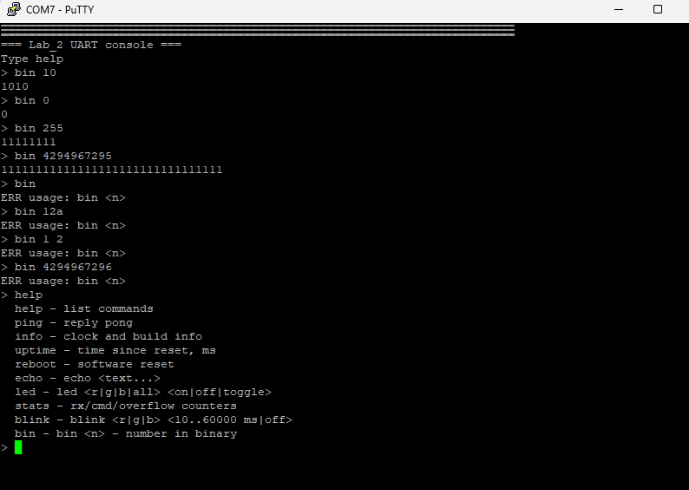

*Figure 22 – Command `bin <n>` with correct and wrong input*

Measurements repeated at 19200 bit/s:

* bit duration on D4 – **51.96 µs**, i.e. **19 246 bit/s** (+0.24 % from 19200, +0.08 % from the actual 19 231);
* reply `1010\r\n` to `bin 10`, from the start bit of the first `0x31` to the start bit of the next `0x3E` –
  **3.116 ms** (calculated `6 · 10 · 52.08 µs = 3.125 ms`, actual 3.12 ms).

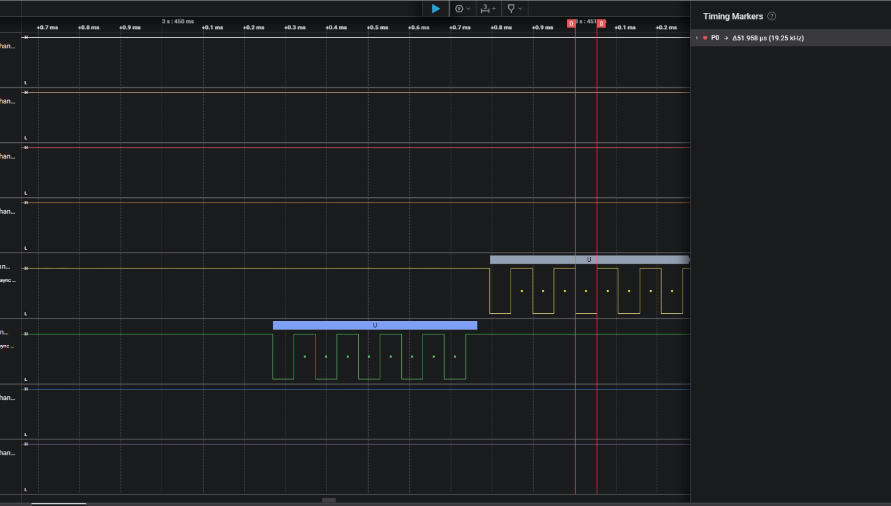

*Figure 23 – Bit duration at 19200 bit/s*

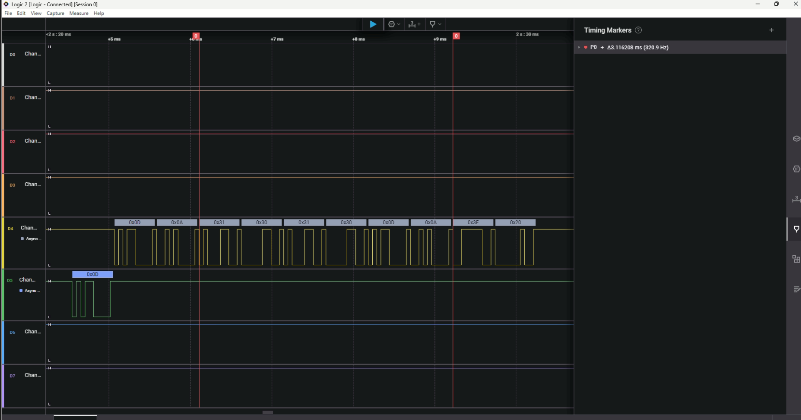

*Figure 24 – Duration of the reply to `bin 10`*

| Parameter | Calculated | IDE actual | Measured (Saleae) |
|-----------|:----------:|:----------:|:-----------------:|
| Baud (115200) | 115200 | 117647 | 117 647 |
| T_bit (115200), µs | 8.68 | 8.50 | 8.50 |
| Duration of `pong\r\n`, µs | 520.8 | 510 | ≈ 510 |
| Blink period `blink g 500`, ms | 1000 | 1000 | 1000.08 |
| Baud (19200) | 19200 | 19231 | 19 246 |
| T_bit (19200), µs | 52.08 | 52.00 | 51.96 |
| Duration of the reply to `bin 10`, ms | 3.125 | 3.12 | 3.116 |

## Conclusions

* The SCB UART was configured in PSoC Creator; for 115200 bit/s the integer divider 17 gives an actual
  rate of 117 647 bit/s (+2.12 %), for the variant speed 19200 bit/s the divider 104 gives 19 231 bit/s
  (+0.16 %) – both values match the customizer, the Clocks tab and the Saleae measurements
  (T_bit = 8.5 µs and 51.96 µs).
* A command-line console with a command table was implemented; `echo`, `led`, `stats` and a
  non-blocking `blink` based on SysTick were added, and for variant 5 the command `bin <n>` with full
  input validation. All three projects build without errors or warnings and were tested on the board.
* Measured on the CY8CKIT-042: echo delay ≈ 10 µs, `ping` reply delay ≈ 10.8 µs, the LED turns on ≈ 36 µs
  after the command, the blink period is 1000.08 ms.
* With mismatched baud rates the data are corrupted on both sides; the parity setting is ignored by the
  KitProg bridge, which supports 8N1 only. For 115200 bit/s OVS 8 or 16 would reduce the baud-rate error
  from 2.12 % to 0.16 %.
